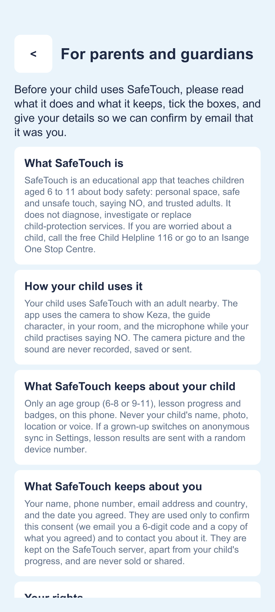
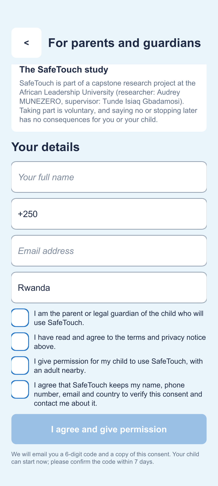
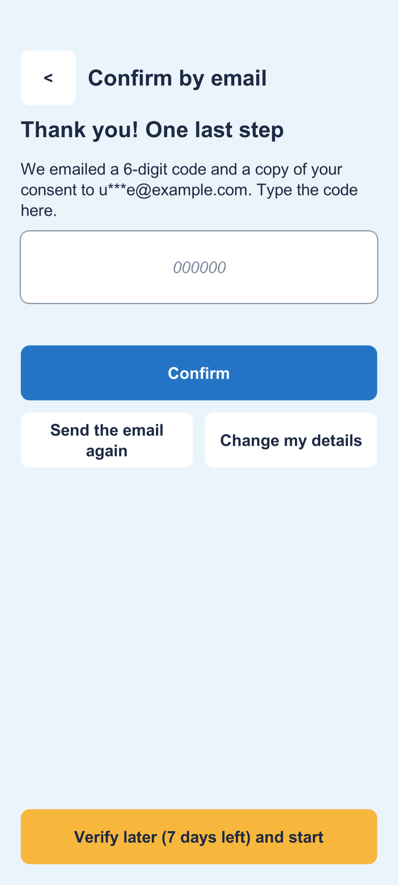

# Parental consent

Before a child uses SafeTouch for the first time, a parent or legal guardian reads the terms, gives permission and confirms it by email. This follows Rwanda's **Law N° 058/2021, Article 9**: processing the personal data of a child under 16 needs the consent of a parent or guardian.

| Terms | Details and agreements | Confirm by email |
|---|---|---|
|  |  |  |

## The flow

1. **Start** opens the consent page until a parent has agreed to the current terms (`ConsentRecord.TermsVersion`).
2. The parent reads six short sections (`Resources/Content/terms.json`, Kinyarwanda in `terms_rw.json`):
   - what SafeTouch is
   - how the child uses it
   - what is kept about the child
   - what is kept about the parent
   - their rights
   - the study
3. They tick **all four** agreements:
   - they are the child's parent or legal guardian;
   - they have read and agree to the terms and privacy notice;
   - they permit the child to use SafeTouch with an adult nearby;
   - SafeTouch may keep their name, phone, email and country to verify this consent and contact them about it.
4. They give their **name, phone number (with country code), email and country**. The app checks the same rules as the API before sending.
5. The API emails a **6-digit code** and a **copy of the consent**: what they agreed, the details they gave, the date and the terms version.
6. The child can start straight away (**Verify later**). The parent types the code within **7 days**. After 7 days, the code is needed before a child can continue.

**Offline:** the consent is saved on the phone and sent automatically once the phone has internet. The verify screen and Grown-ups › Settings say so.

## What is stored, and where

| Data | Where | Why |
|---|---|---|
| Parent's name, phone, email, country, consent date, terms version, the four agreements | The phone (PlayerPrefs, `safetouch.consent.v1`) and the SafeTouch API, in a `consents` collection **separate from progress** | To verify the consent by email and contact the parent about it |
| Verification code | API only, as a **SHA-256 hash**, expiring after 24 hours | To check the code the parent types |
| Child's age group, progress, badges | The phone; anonymous sync only if switched on | Unchanged: never the child's name, photo, location or voice |

The child's data is still anonymous, but the parent's details are **personal data**. The proposal's NFR1 ("the app collects no personal data") and the ethics application should be updated to say:

> The app collects no personal data about the child. It collects the parent's name, phone, email and country, with their consent, only to verify that consent.

## The API (`backend/src/consent.js`)

| Endpoint | What it does |
|---|---|
| `POST /api/consent` | Validates and saves a consent, then emails the code. Sending the same details again (an offline retry) sends no second email; a corrected email address gets a new code. |
| `POST /api/consent/:id/verify` | `{ "code": "123456" }`. 5 tries per code; codes expire after 24 hours. |
| `POST /api/consent/:id/resend` | New code. At most once a minute and 5 times a day. |
| `GET /api/consent/:id` | Status only: verified or not, and a masked email (`u***e@example.com`). No name or phone. |
| `DELETE /api/consent/:id` | Withdrawal: deletes the consent and that device's synced progress. |
| `GET /api/summary` | Now also counts consents (total and verified); totals only. |

Unknown fields are refused, so a payload can't carry anything else (for example a child's name). 19 tests cover the API: `cd backend && npm test`.

## Email

Set the provider in `backend/.env` (see `.env.example`):

```
MAIL_PROVIDER=brevo        # or resend; "console" prints emails instead (the default)
MAIL_API_KEY=...           # from the provider's dashboard
MAIL_FROM=safetouch@your-verified-domain.org
```

Both Brevo (300 emails a day) and Resend have free tiers. The sender address must be verified with the provider. Without a provider, the API prints each email in its console, so the flow can be tested end to end on a laptop.

The email is in the parent's chosen language (English or Kinyarwanda), and the parent's name is HTML-escaped.

## Connecting the app

`ConsentService` (on the **SafeTouch App** object in the scene) has a **Base Url**, `http://localhost:3000` by default.
- **On the phone:** use the deployed API's `https://` address. Android blocks plain `http` in release builds.
- **During development:** a development build can reach the API on your laptop at `http://<laptop-ip>:3000` (SafeTouch › 1. Configure allows this for development builds only). Phone and laptop must be on the same Wi-Fi.

## Withdrawing

Grown-ups › Settings › **Withdraw consent and delete data** (tap twice). It immediately:
- deletes the consent and the child's progress from the phone;
- asks the API to delete the parent's details and the synced progress. Offline, the request is kept and retried until it succeeds.

The app then returns to the start, and the next use needs a new consent.

## Still to do before the pilot

- A native speaker should review the Kinyarwanda terms and email; the supervisor and ethics committee should review the terms.
- Add the research team's contact email to the "SafeTouch study" section.
- Deploy the API with HTTPS and an email provider, and set `ConsentService` → Base Url.
- Decide how long consent records are kept after the study, and add that to the terms.
- Phone numbers are collected but not verified (SMS would need a paid provider).
