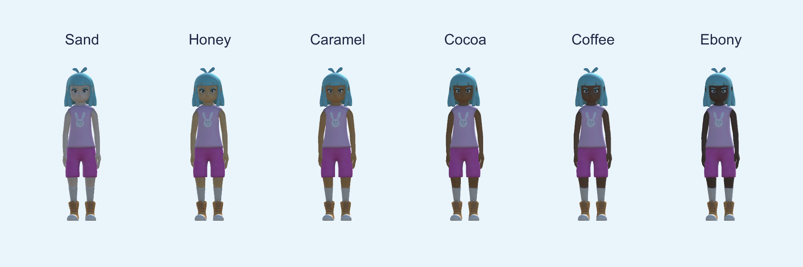
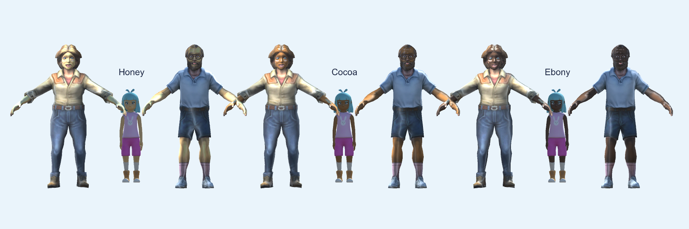

# Keza's look: girl or boy helper, and skin tones

## A girl or a boy helper

The helper carries the child's name, so the child picks one like them: **a girl, Keza**, or **a boy, Ganza** (a Rwandan boy's name). They pick on the name screen after consent, and can change it any time in **Keza's look**; the other helper then appears in the same spot.

- If the child types their own name, the helper carries it either way. If they skip, the helper is Keza or Ganza, and every text uses that name.
- **Keza and Ganza look like real children**, like the classmate. Both are made from the same lifelike child model by **SafeTouch > 10. Build Lifelike Keza, Ganza and Family** ([SafeTouchCharacters.cs](../Assets/SafeTouch/Editor/SafeTouchCharacters.cs)):
  - **Keza:** dark hair, a yellow top, denim shorts and brown boots, instead of teal hair and pink clothes.
  - **Ganza:** his hair is cut short (the model's bob is lifted to just above the ears and shaped to his head), with black hair, a green top, khaki shorts and dark trainers.
  - Both wave with the model's greeting, and their skin takes the tone the child picks.
  - The bunny with crossed-out eyes printed on the model's top is painted out.
  - The same command builds the classmate, Mum, Dad and the dog, and puts them all on ARManager in the scene.
- Without those prefabs, Ganza falls back to simple shapes ([BoyModel.cs](../Assets/SafeTouch/Scripts/AR/BoyModel.cs)), the same height as Keza: short hair, a blue T-shirt, shorts, trainers and a smile.
- To use a modelled boy instead, set **Boy Prefab** on `ARManager`.
- The simple-shapes Ganza has a child's real proportions (his head about a fifth of his height), a friendly face with a smile, and jointed arms and legs. [BoyMotion.cs](../Assets/SafeTouch/Scripts/AR/BoyMotion.cs) moves him without animation files: he steps, swings his arms and bobs when he walks or runs, breathes and looks about when he stands, and waves when he says hello.

## Ages 9 to 11: their own, more lifelike characters

The 9 to 11 (Guardian) path can have its own characters, made from models you download. The 6 to 8 (Explorer) path keeps Keza, Ganza and its own people.

**1. Download.** Good models are:
- one person, standing, facing forward;
- an FBX file, or a Unity prefab with its textures;
- free to use in an app (for example CC0, or a Mixamo character). Keep a note of where each came from in [assets.md](assets.md).
- With an **Idle** animation (and a **Wave**), they move; without one, they stand still. On Mixamo, download the character with the "Idle" animation, "With Skin".

**2. Put them in** `Assets/SafeTouch/Models/Ages 9-11`:
- a file or folder with **girl** in its name becomes the girl helper;
- one with **boy** in its name becomes the boy helper;
- any other model becomes one of the **people**: visitors, trusted adults and the people in the stories.

**3. In Unity, run SafeTouch > 8. Make Ages 9-11 Characters From Downloaded Models.** For each model it:
- scales it (children 0.62 m, a little taller than Keza; grown-ups 0.78 m), stands it on the floor and centres it;
- adds the name tag, the touch area and the skin tone (the skin tone works when the skin has its own material with "skin" in its name);
- takes off movement scripts, physics and cameras that came with the download;
- makes an animator: the clip named "idle" (or the first one) loops, and a clip named wave, greet or hello plays when the helper says hi;
- saves the prefabs in `Prefabs/Ages 9-11` and sets them on `ARManager` in the scene (**Older Girl Prefab**, **Older Boy Prefab**, **Older Figure Variants**). Rebuilding the scene keeps them.

It warns if a model looks wider than one person (two people in one file, or a T-pose without animations). Run it again whenever you add or change a model.

**4. In the app**, a child on the 9 to 11 path sees these characters; switching path in the lesson map swaps the helper at once. Anything not set falls back to the 6 to 8 character.
- The choice stays on the phone and is never synced (consent terms version 1.4).

## Skin tones

Children choose Keza's skin tone on **Home → Keza's look**, so the guide can look like them or a friend. Every visitor and helper in the lessons also gets a tone from the same palette, so each lesson shows a mix of people.

| Id | Name | Colour |
|---|---|---|
| sand | Sand | `#F2D1B3` |
| honey | Honey | `#E0AC69` |
| caramel | Caramel | `#C68642` |
| cocoa | Cocoa (default) | `#8D5524` |
| coffee | Coffee | `#6A3F23` |
| ebony | Ebony | `#432818` |

Names are foods and woods, never ethnic labels. The default is Keza's original colour, so nothing changes for a child until they pick.

## The effect

When Keza is already in her 3D world, the screen stays see-through and the change plays on her there:
- the colour blends over 0.6 s with a soft glow halfway;
- sun-yellow and new-tone dots burst up around her;
- she waves (or hops, on the simple figure).

If Keza isn't placed yet, a drawn face previews the tone.

## How skin is found

`SkinToneApplier` finds skin by material or part name (`skin`, `head`, `face`, `hand`, `realismbody`), so it works on both the simple figures and the imported models. Everything is painted with a `MaterialPropertyBlock`, so shared material assets never change.

The Mixamo Keza has **one** texture for skin and clothes. For her, `SafeTouch > 4. Build Character Prefabs From Models` does two things:
1. Generates a **skin mask** from the texture. A pixel counts as skin if it is warm (red above green and blue) with green and blue close together. That covers 29% of the atlas and excludes her lilac top, magenta shorts, orange boots, cream socks and teal hair.
2. Gives her the **`SafeTouch/Skin Tone`** shader. Masked pixels take the chosen tone, scaled by each pixel's brightness compared with the painted skin, so shading stays.

The tone id is saved in Progress (`skinTone`). It describes Keza, not the child, and is not sent by cloud sync.

## Keza's family

Mum and Dad (from the parents-and-dog model) take the tone the child picks for Keza, so they look like her family wherever a lesson brings in a parent: the Trusted Adults lesson, the STOP lesson's "keep telling" step and the home chase in the Memory Quest. Other visitors keep a mix of tones.

Their texture also holds hair, a beard and clothes, so their masks are built more carefully:
1. Only the texture areas used by their **skin parts** count: head, arms and legs for Dad; head and hands for Mum. Clothes keep their own material, even where Mum's shirt shares texture pixels with her neck.
2. Within those areas, a pixel is skin if its hue, saturation and brightness are close to the skin painted on the arms or hands. That leaves out the beard (too dark), light hair (too saturated), teeth and eyes (too white) and lips (too red).
3. The mask is smoothed and then sharpened, so stray strands of hair don't speckle and shadowed eyelids don't leave holes.

Dad's lens meshes imported as opaque dark discs, so they are hidden and his glasses show as frames.
