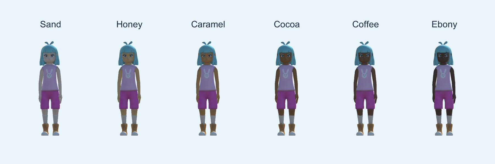

# Keza's look: skin tones

Children choose Keza's skin tone on **Home → Keza's look**, so the guide can look like them or a friend. Every visitor and helper in the lessons also gets a tone from the same palette, so each lesson shows a mix of people.

| Id | Name | Colour |
|---|---|---|
| sand | Sand | `#F2D1B3` |
| honey | Honey | `#E0AC69` |
| caramel | Caramel | `#C68642` |
| cocoa | Cocoa (default) | `#8D5524` |
| coffee | Coffee | `#6A3F23` |
| ebony | Ebony | `#432818` |

Names are foods and woods, never ethnic labels. The default is Keza's original colour, so nothing changes for a child until they pick.

## The effect

When Keza is already in the room, the screen stays see-through and the change plays on her in AR:
- the colour blends over 0.6 s with a soft glow halfway;
- sun-yellow and new-tone dots burst up around her;
- she waves (or hops, on the simple figure).

If Keza isn't placed yet, a drawn face previews the tone.

## How skin is found

`SkinToneApplier` finds skin by material or part name (`skin`, `head`, `face`, `hand`, `realismbody`), so it works on both the simple figures and the imported models. Everything is painted with a `MaterialPropertyBlock`, so shared material assets never change.

The Mixamo Keza has **one** texture for skin and clothes. For her, `SafeTouch > 4. Build Character Prefabs From Models` does two things:
1. Generates a **skin mask** from the texture. A pixel counts as skin if it is warm (red above green and blue) with green and blue close together. That covers 29% of the atlas and excludes her lilac top, magenta shorts, orange boots, cream socks and teal hair.
2. Gives her the **`SafeTouch/Skin Tone`** shader. Masked pixels take the chosen tone, scaled by each pixel's brightness compared with the painted skin, so shading stays.

The tone id is saved in Progress (`skinTone`). It describes Keza, not the child, and is not sent by cloud sync.
